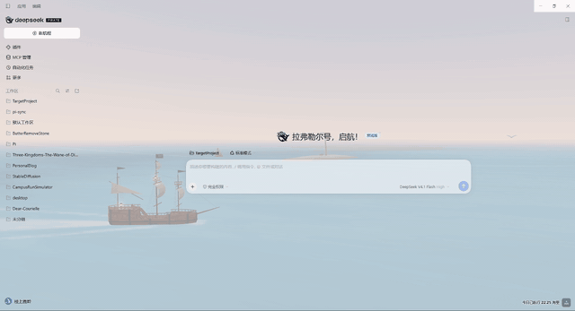
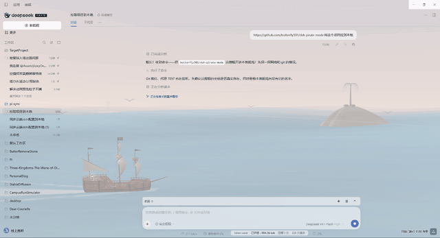
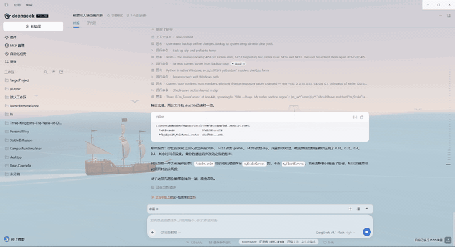
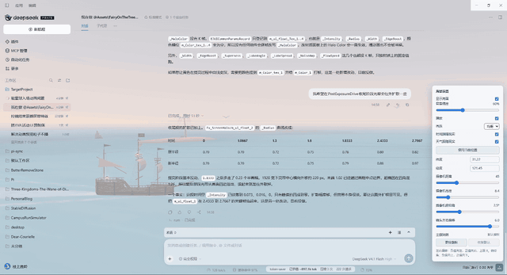

English · [简体中文](README.md)

# dsh-pirate-mode

A complete pirate mode for DeepSeek Harness: you are the pirate captain, the agent is your first mate, and a 3D ocean that follows the local time of day and real weather stretches out behind the window, with a full set of nautical interactions and sounds.

## Preview

**Home.** The sidebar icon becomes a pirate whale, the wordmark carries PIRATE, and the top-left button reads "New voyage". The sea runs behind the window, and the bottom right corner counts the nautical miles sailed today.



**Conversation.** The first mate answers in a sailor's voice, and both the agent identity and the subagent roles are phrased as nautical ranks. The bottom right corner keeps the running total of miles.



**Working.** While a task runs, thoughts and shell commands scroll by one line at a time and the answer carries code cards. The status bar waits for its next rotation window before changing phrase and color.



**Day, night and weather.** The ocean panel on the settings page previews live: the sky walks from daylight into dusk and overcast while the water shifts with it.



## What changes once it is installed

- **First-mate persona and ship identity.** You are the captain and the agent is your first mate. The Ship identity panel lets you rename the ship and the first mate, and upload a main mast flag as PNG, JPEG or WebP. The ship name is only prepended to the pirate-locale home title and the opening of the persona prompt; the first mate name is only appended to the persona opening. Neither rewrites your own glossary terms.
- **An ocean driven by time of day and weather.** The main agent sails with full canvas while working and furls part of it when idle, and every subagent gets an escort boat. Day and night blend smoothly across a 24-hour palette with twin lanterns for night sailing. Clear, rain and snow are all supported, including real weather resolved from your IP location.
- **Staged status phrases and coloring.** The running status line rotates through three stages, starting, cruising and prolonged, according to how long it has waited, and switches text color per stage. A stage change waits for the next rotation window so the line never flickers.
- **Nautical notification sounds.** Offline recordings: a ship's bell for completion, a great horn for failures and a boatswain's whistle when a confirmation is pending. By default they only fire while the window is unfocused or in the background, a user-initiated cancel stays silent, and the same event type is throttled to once every 2 seconds. Custom audio can be uploaded and previewed.
- **Crew morale, `/rum` and the window-shake easter egg.** Morale is tracked in memory per session, with no progress bar or numbers exposed. Low morale produces intermittent complaints in the status bar. Typing `/rum` in the input restores morale at once and fires a full-screen gold-coin confetti, without sending a message or consuming tokens. Shaking the desktop window hard from side to side triggers a big swell and a remark from the status bar.
- **Eight languages out of the box.** Chinese, English, Japanese, Spanish, French, German, Russian and Portuguese. First activation switches to the matching pirate locale automatically.

## Requirements

- Node.js `>=24.9.0`
- DeepSeek Harness `>=0.2.2-rc.5 <0.3.0`

## Install

From a terminal, install the bundle into the desktop profile:

```bash
dsh plugin --profile desktop add dsh-pirate-mode
```

Then add `"dsh-pirate-mode"` to the `dsh.profile.bundles` list in `~/.dsh/profiles/desktop/package.json` and restart DeepSeek Harness. You can also search for `dsh-pirate-mode` in the DeepSeek Harness plugin manager and install it there.

Installing this one bundle pulls in all nine underlying packages, so there is no need to add them one by one:

- [`dsh-brand-pack-loader`](https://github.com/butterfly301/dsh-brand-pack-loader)
- [`dsh-locale-pack-loader`](https://github.com/butterfly301/dsh-locale-pack-loader)
- [`dsh-rotate-status-text`](https://github.com/butterfly301/dsh-rotate-status-text), which also has its own settings page in the sidebar, kept in sync with the bundle
- [`dsh-ocean-background`](https://github.com/butterfly301/dsh-ocean-background), which adds its own non-blocking panel in the bottom right corner of the window for the ocean, day/night, weather and flag
- [`dsh-prompt-loader`](https://github.com/butterfly301/dsh-prompt-loader)
- [`dsh-window-shake`](https://github.com/butterfly301/dsh-window-shake)
- [`dsh-sound-pack-loader`](https://github.com/butterfly301/dsh-sound-pack-loader), which also has its own settings page in the sidebar, kept in sync with the bundle
- [`dsh-confetti`](https://github.com/butterfly301/dsh-confetti)
- [`dsh-crew-morale`](https://github.com/butterfly301/dsh-crew-morale)

If a release is very fresh, pnpm's `minimumReleaseAge` cooldown may block a direct command-line install. Either add `dsh-pirate-mode` to `minimumReleaseAgeExclude` in `~/.dsh/profiles/desktop/pnpm-workspace.yaml`, or install through the plugin manager built into DeepSeek Harness.

## Configuring it

Open the Pirate mode page in settings and everything is adjustable from one place:

- **Master switch with persisted protection.** Turning the master switch off and saving safely disables the pirate icons, copy, status phrases, prompts, sounds, morale, confetti and window shake, and keeps a backup. Turn the switch back on after restarting DSH and your earlier customization is restored as it was.
- **Ship identity.** Rename the ship and the first mate with a live preview, and upload or restore the main mast flag.
- **Locale content.** Edit per language: interface copy, staged status phrases, window-shake remarks, rotation interval and stage durations, the first-mate persona prompt, and the `/rum` description and crew morale lines. Changes apply immediately and survive upgrades.
- **Ocean controls.** Handled separately by the ocean button in the bottom right corner of the window: background strength, quality, camera parameters, following real day/night and weather, and the main flag.

To ship a default pirate pack for another language, drop files for that language ID into `content/`:

```text
content/
├── identity/<langId>.json   # ship name, first-mate name and home title prefix template
├── messages/<langId>.json   # interface buttons and titles
├── morale/<langId>.json     # crew morale and /rum lines
├── phrases/<langId>.json    # staged status phrases and window-shake remarks
└── prompts/<langId>.txt     # first-mate persona prompt body
```

## Bundled assets and third-party notices

- `assets/sounds/*.wav`: original short offline nautical sounds, a ship's bell, a great horn and a boatswain's whistle, each under one second, distributed with the plugin under the MIT license.
- `dsh-confetti/vendor/confetti.browser.js`: from [catdad/canvas-confetti](https://github.com/catdad/canvas-confetti) v1.9.3, ISC license.

## Uninstall

Remove the package and delete `"dsh-pirate-mode"` from the `dsh.profile.bundles` list in `~/.dsh/profiles/desktop/package.json`:

```bash
dsh plugin --profile desktop remove dsh-pirate-mode
```

If this voyage makes your sessions more fun, a star on the repo is appreciated.

## License

MIT
