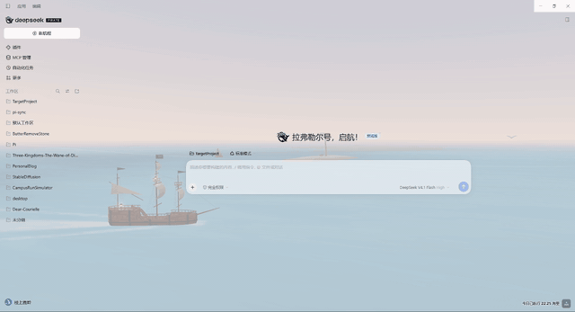
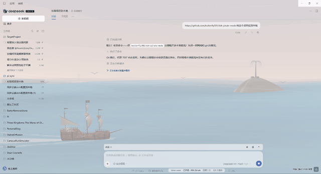
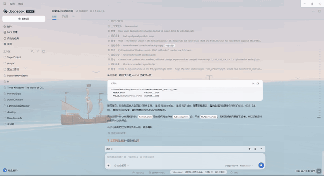
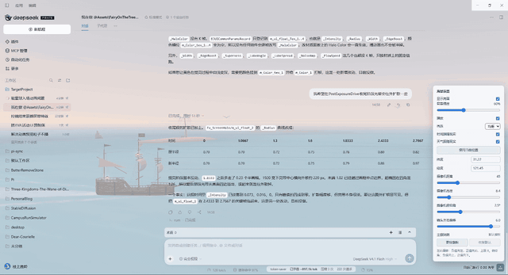

# dsh-pirate-mode

给 DeepSeek Harness 加上一套完整的海盗模式：你是海盗船长，Agent 是你的大副，窗口后面铺开一片会随昼夜和真实天气变化的 3D 海面，并带有一整套航海交互与音效体验。

## 界面预览

首页：侧栏换成海盗鲸鱼图标，字标挂上 PIRATE，左上角按钮成了“新航程”，窗口后面是一片航行中的海，右下角记着今天已经航行了多少海里。



对话：大副用航海口吻回话，身份与子代理分工都用航海称谓讲，右下角记着目前一共航行了多少海里。



常态：任务执行中，思考与运行命令逐条滚动，回答下方挂着代码卡片，状态栏等到下一轮换窗口时才切换短句与颜色。



昼夜与天气：设置页右侧的海景面板实时预览，天空跟着当地时间从白日走向黄昏与阴天，海面同步换色。



## 装完之后会变成什么样

- **大副人格与船只身份**：你成了船长，Agent 是你的大副；支持在设置页「船只身份」自定义船名、大副名和主桅大旗（PNG / JPEG / WebP），船名仅前置在海盗语种首页标题与人格开头，大副名仅追加在人格开头，不改写用户原文词典。
- **昼夜与天气联动海景**：主 Agent 航行中扬满帆、待命时收起部分帆，每个子代理派出一艘伴航小艇；支持按当地时间 24 小时平滑切换昼夜与夜航双提灯，支持晴、雨、雪及按 IP 定位拉取现实天气。
- **分段状态短句与状态着色**：运行状态行按等待时长分「起步 / 推进 / 漫长」三段轮换并随阶段切换文字颜色，跨段时等到下一个轮换窗口再切换以避免闪烁。
- **航海通知音效**：内置船铃（完成）、大船号角（异常失败）、水手长哨（等待确认）离线音效，默认仅在窗口失焦或后台时触发，用户主动取消保持静音，同类事件 2 秒节流，并支持上传自定义音频与试听。
- **船员士气、`/rum` 与摇晃彩蛋**：按会话在内存中记账，不展示进度条或数值，低士气时在状态栏间歇抗议；在输入框输入 `/rum` 可立即恢复士气并触发全屏金币彩带（不产生消息或 token 消耗）；桌面端剧烈左右摇晃窗口时触发海面大浪与状态栏吐槽。
- **8 语种开箱覆盖**：覆盖中文、英语、日语、西班牙语、法语、德语、俄语和葡萄牙语，首次启用自动切到对应海盗语种。

## 环境要求

- Node.js `>=24.9.0`
- DeepSeek Harness `>=0.2.2-rc.5 <0.3.0`

## 安装

打开终端，把插件装进桌面 profile：

```bash
dsh plugin --profile desktop add dsh-pirate-mode
```

随后在 `~/.dsh/profiles/desktop/package.json` 的 `dsh.profile.bundles` 列表里加上 `"dsh-pirate-mode"`，重启 DeepSeek Harness 即可。也可以直接在 DeepSeek Harness 的插件管理器中搜索 `dsh-pirate-mode` 安装并启用。

安装这一个主包会自动带齐底层的 9 个独立组件，不用手动逐个安装：

- `dsh-brand-pack-loader`
- `dsh-locale-pack-loader`
- `dsh-rotate-status-text`（在设置侧栏也提供独立设置页，与整合包同步）
- `dsh-ocean-background`（在窗口右下角提供专属不遮挡浮窗面板，包含海景、昼夜天气与主旗更换）
- `dsh-prompt-loader`
- `dsh-window-shake`
- `dsh-sound-pack-loader`（在设置侧栏也提供独立设置页，与整合包同步）
- `dsh-confetti`
- `dsh-crew-morale`

如果新版本刚发布到 npm，命令行直装遇到 pnpm 的 `minimumReleaseAge` 冷却拦截，可以在 `~/.dsh/profiles/desktop/pnpm-workspace.yaml` 的 `minimumReleaseAgeExclude` 下把 `dsh-pirate-mode` 加入白名单，或者改用 DeepSeek Harness 内置插件管理器安装。

## 怎么调、怎么改

装好后打开设置的「海盗模式」页面就能统一调整：

- **总开关持久化保护**：关掉总开关并保存会把海盗图标、文案、状态词、提示词、音效、士气、彩带与窗口摇晃全部安全停用并持久化备份；即便重启 DSH 后再打开总开关，之前的自定义配置仍会原样恢复。
- **船只身份**：自定义船名、大副名并实时预览效果，上传或恢复主船主旗。
- **语种内容**：按语种编辑界面文案、分段状态词、窗口摇晃吐槽、轮换间隔与分段秒数、大副人格提示词，以及 `/rum` 说明与船员士气台词，保存后立即生效、升级不覆盖。
- **海景控制**：由窗口右下角的海景按钮单独控制，支持背景强度、画质、镜头参数、现实昼夜/天气跟随与主旗更换。

如果想给其他语言新增一套默认海盗包，往包里 `content/` 目录下放对应语言 ID 的文件就行：

```text
content/
├── identity/<langId>.json   # 船名、大副名与首页前缀模板
├── messages/<langId>.json   # 界面按钮与标题文案
├── morale/<langId>.json     # 船员士气与 /rum 台词
├── phrases/<langId>.json    # 分段状态短句与摇晃吐槽
└── prompts/<langId>.txt     # 大副人格提示词正文
```

## 随包素材与第三方署名

- `assets/sounds/*.wav`：自制离线航海短音（船铃、大船号角、水手长哨），均小于 1 秒，随插件在 MIT 许可下打包分发。
- `dsh-confetti/vendor/confetti.browser.js`：来自 `catdad/canvas-confetti` v1.9.3（ISC 许可证）。

## 卸载

执行下面的命令卸载，再从 `~/.dsh/profiles/desktop/package.json` 的 `dsh.profile.bundles` 中删掉 `"dsh-pirate-mode"`：

```bash
dsh plugin --profile desktop remove dsh-pirate-mode
```

## 许可

MIT
